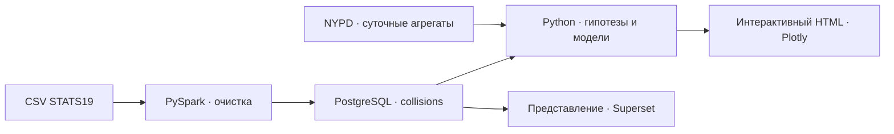

# Анализ ДТП в Великобритании

Проект обрабатывает открытые данные STATS19 о зарегистрированных полицией ДТП с пострадавшими. PostgreSQL хранит всю доступную историю. Гипотезы, регрессия и классификация используют полный период 2022–2024. Исходный файл, скачанный 25 ноября 2026 года, занимает **1 534 937 928 байт** и содержит **9 116 625 записей за 1979–2025 годы**. [Данные и словарь STATS19](https://www.gov.uk/government/statistical-data-sets/road-safety-open-data)

## Архитектура



Docker Compose запускает два сервиса. В `airflow` работает Apache Airflow, который запускает Apache Spark в локальном режиме с двумя потоками, затем запускает Python-анализ. Сервис `postgres` хранит таблицу ДТП. Docker volumes сохраняют базу, историю запусков и результаты.

DAG [road_safety](dags/road_safety.py) запускается вручную и выполняет три задачи.

| Задача | Что происходит |
|---|---|
| `check_source` | Проверяет наличие CSV, размер больше 0,5 ГБ и восемь нужных столбцов. |
| `load_collisions` | Spark очищает поля, исключает строки без корректного ID или года и убирает точные дубликаты. Python загружает части CSV через PostgreSQL `COPY` и обновляет таблицу по ключу `collision_index`. |
| `analyze` | Python читает данные из PostgreSQL, проверяет гипотезы, строит модели и сохраняет сводки с интерактивным дашбордом. |

[etl.py](etl.py) проверяет полноту ключа, приводит числовые поля, даты и время к нужным типам. Некорректные дата и время становятся `NULL`. Если внутри CSV один ID имеет разные значения, PostgreSQL откатывает загрузку. Повтор того же файла сохраняет число строк. Изменённые записи обновляются по ключу, записи прошлых загрузок сохраняются. Схема и представление находятся в [sql/](sql/).

## Запуск через Docker

1. Откройте папку проекта. Скопируйте `.env.example` в `.env` и задайте пароль для новой базы. Для уже созданной базы используйте существующий `.env`.
2. Скачайте **Collisions – 1979 – Latest Published Year** и поместите CSV по пути ниже. Сборка образа и Git исключают папку `data/raw`. [Скачать исходный CSV](https://data.dft.gov.uk/road-accidents-safety-data/dft-road-casualty-statistics-collision-1979-latest-published-year.csv)

   ```text
   data/raw/dft-road-casualty-statistics-collision-1979-latest-published-year.csv
   ```
3. Запустите сервисы.

   ```bash
   docker compose up -d --build
   docker compose ps
   docker compose exec airflow cat /opt/airflow/standalone_admin_password.txt
   ```

   Откройте Airflow по адресу <http://localhost:8080>. Войдите как `admin` с выведенным паролем. В списке DAG включите `road_safety` и нажмите **Trigger DAG**. Вкладка **Grid** показывает состояние задач, **Logs** показывает результат каждой задачи. Порт можно задать в `.env` через `AIRFLOW_PORT`.
4. Когда все три задачи завершатся успешно, скопируйте результаты и откройте дашборд.

   ```bash
   docker compose cp airflow:/opt/airflow/results/. results/latest
   ```

   Откройте `results/latest/dashboard.html` в браузере. Выпадающее меню выбирает период для тепловой карты и двух сравнений тяжести. Годовая динамика показывает всю историю. Наведение показывает количество ДТП или числитель и знаменатель доли.

Для проверки загрузки выполните `docker compose exec postgres psql -U road_user -d road_safety -c "SELECT COUNT(*) FROM public.collisions;"`. Если вы поменяли имя пользователя или базы, подставьте значения из `.env`. Остановить сервисы можно командой `docker compose stop`.

## Гипотезы, модели и результаты

| Гипотеза | Как проверяем |
|---|---|
| **H1.** Доля тяжёлых и смертельных ДТП выше на дорогах с лимитом 50–70 mph по сравнению с 20–30 mph. | Односторонний Z-тест двух долей. Сравниваем зарегистрированные ДТП с известной тяжестью. |
| **H2.** Доля тяжёлых и смертельных ДТП выше в темноте без освещения по сравнению с дневным светом. | Односторонний Z-тест двух долей по кодам освещения 6 и 1. |
| **H3.** Среднее число ДТП за час выше в 07:00–09:59 и 16:00–18:59 по сравнению с остальными часами. | Для каждого дня делим число ДТП в двух группах на 6 и 18 часов. Односторонний t-тест проверяет среднюю дневную разность. |

Уровень значимости 0,05. К трём проверкам STATS19 применяется поправка Бонферрони. Тяжесть 1 и 2 объединяется в один класс, код 3 составляет второй класс. Ассоциации оцениваются по зарегистрированным ДТП. Для оценки риска на поездку нужны данные об объёме движения. Связь ДТП по времени и месту влияет на точность p-value. Ноль в столбце p-value означает численное округление.

На проверенном срезе все три теста отклонили нулевые гипотезы после поправки. Доля тяжёлых и смертельных ДТП составила **30,74%** при лимите 50–70 mph и **21,73%** при 20–30 mph. В темноте без освещения доля составила **34,68%**, при дневном свете **23,08%**. В часы пик зарегистрировано в среднем **18,41 ДТП/ч**, в остальные часы **9,64 ДТП/ч**. В Нью-Йорке средние составили **5,89** и **4,12 ДТП/ч** соответственно.

Классификация тяжести на данных 2024 года дала ROC-AUC **0,613** и F1 **0,408**. Для прогноза самого частого класса ROC-AUC составил **0,500**.

| Файл в `results/latest/` | Содержимое |
|---|---|
| `load_report.json` | Размер CSV, количество прочитанных, отклонённых и повторяющихся строк, изменения в БД, пропуски даты и времени. |
| `annual.csv` | Количество ДТП по годам за всю загруженную историю. |
| `hypotheses.csv` | Значения по группам, разницы, p-value с поправкой и выводы по трём гипотезам. |
| `external_h3.csv` | Результат проверки H3 на данных Нью-Йорка. |
| `regression.csv` | Отношения шансов из описательной логистической регрессии с учётом скорости, освещения, года и полицейского подразделения. |
| `ml_metrics.csv` | Классификация тяжести среди зарегистрированных ДТП. Обучение на 2022–2023 годах, проверка на 2024-м. Логистическая регрессия сравнивается с прогнозом самого частого класса по precision, recall, F1, ROC-AUC и average precision. |
| `dashboard.html` | Интерактивный дашборд Plotly, который открывается в браузере без подключения к базе. |

[analysis.py](analysis.py) выполняет расчёты. [analysis-2.ipynb](analysis-2.ipynb) открывает полученные сводки для разбора на защите, если на компьютере уже есть Jupyter и pandas.

### Внешний источник для H3

Для проверки воспроизводимости направления связи использован независимый источник NYPD за тот же период. Срез получен 25 ноября 2026 года. В запросе выбраны ДТП с известным временем, где пострадал или погиб хотя бы один человек. Исходные записи сгруппированы по календарной дате и по тем же шести часам пик. Дневные агрегаты хранятся в [CSV](data/reference/nyc_crashes_daily_2022_2024.csv). Анализ одинаково считает среднее число ДТП за час для каждой территории. Правила регистрации и транспортный поток различаются, поэтому сравнивается направление связи. [NYC Open Data](https://data.cityofnewyork.us/d/h9gi-nx95)

Чтобы повторить выгрузку, передайте в API `https://data.cityofnewyork.us/resource/h9gi-nx95.json` параметры SoQL.

```sql
SELECT crash_date AS date,
       case(substring(crash_time,1,2) in ('07','08','09','16','17','18'),
            'peak', true, 'other') AS period,
       count(*) AS collisions
WHERE crash_date >= '2022-01-01T00:00:00' AND crash_date < '2025-01-01T00:00:00'
  AND crash_time IS NOT NULL
  AND (number_of_persons_injured > 0 OR number_of_persons_killed > 0)
GROUP BY date, period
ORDER BY date, period
LIMIT 3000
```

Сведите два значения `period` в столбцы `peak` и `other` для каждой даты.

### Superset

Доступен существующий [экспорт дашборда](dashboard_export_20261124T212929.zip). После задачи `load_collisions` представление `public.collisions_dashboard` готово для импорта. В Superset откройте **Dashboards → Import**, выберите ZIP и подключите базу из `.env`. Для Superset в той же сети Docker Compose используйте адрес `postgres:5432`. Дашборд Plotly доступен сразу после DAG. [Установка Superset](https://superset.apache.org/docs/quickstart/)

## Команда

| Участник | Зона ответственности по исходному проекту |
|---|---|
| Иван Ф | Архитектура, PostgreSQL, Docker и окружение. |
| Артём | Подготовка данных, ETL и контроль качества. |
| Иван А | Статистические проверки, регрессия и ML. |
| Кира | Формулировка гипотез, визуализация и выводы. |

Для сдачи сверьте названия ролей с лекцией № 1. Описание задания задаёт размер группы 4–5 человек.
